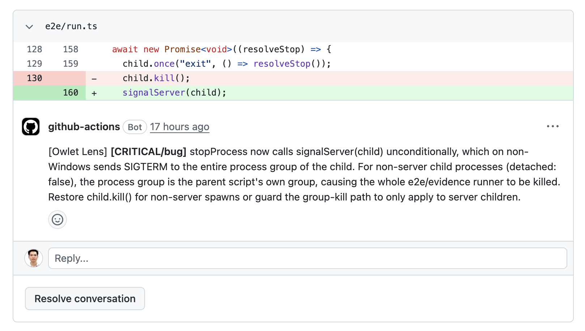
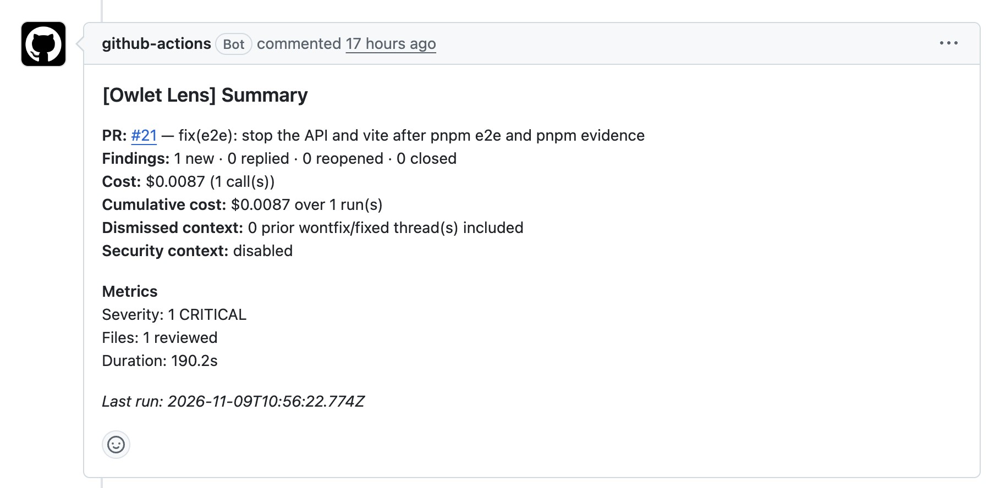

<h1 align="center">
  <picture>
    <source media="(prefers-color-scheme: dark)" srcset="docs/assets/logo/owlet-lens-dark.svg">
    
  </picture>
</h1>

**English** · [Tiếng Việt](./README.vi.md)

<p align="center">
  
</p>

[](https://github.com/openwt-vn/owlet-lens/actions/workflows/ci.yml)


AI code review for pull requests. It posts findings as inline review threads, reads developer replies, and closes threads that are fixed or declined. Runs on GitHub (this page), plus Bitbucket Cloud (Cloud only), GitLab ([setup](./docs/gitlab-setup.md)) and Azure DevOps ([setup](./docs/usage.md#review-provider-github-bitbucket-gitlab-or-azure-devops)).

## Why

- **It talks back.** It reads each developer reply and decides: fixed, will not fix, or still open.
- **It cleans up after itself.** Fixed threads close and regressions reopen, so the thread list matches the code.
- **It learns.** Findings your team keeps declining become proposed coding-standards rules, in a pull request that a person approves.
- **It runs where you are.** Four platforms, several AI providers (including local models), and nothing to host: no database, no server.

## How it works


1. **Review** (PR opened / pushed): sends the diff to an LLM, posts new findings, replies on ones still open, reopens regressions, closes fixed ones, and keeps one summary comment up to date.
2. **Reply** (developer answers in a review thread): an LLM reads the conversation and decides `fixed`, `wontfix` or `active`, then updates the thread.
3. **Learn** (on a schedule, optional): finds findings your team keeps declining and proposes new coding-standards rules in a pull request. A person always approves it; nothing merges by itself.

No database: review state lives in hidden markers inside the comments, and learned rules live in a file in your repo.

## Quick start (GitHub)

**1. Add a secret.** Repo → Settings → Secrets and variables → Actions → `ANTHROPIC_API_KEY` (other providers: [below](#choose-an-llm-provider)).

**2. Add `.github/workflows/ai-review.yml`:**

```yaml
name: Owlet Lens
on:
  pull_request:
    types: [opened, synchronize, reopened]
  pull_request_review_comment:
    types: [created]

jobs:
  review:
    if: github.event_name == 'pull_request'
    runs-on: ubuntu-latest   # or self-hosted
    permissions:
      contents: read
      pull-requests: write
    steps:
      - uses: actions/checkout@v4
        with: { fetch-depth: 0 }   # the review needs full history to diff
      - uses: openwt-vn/owlet-lens@v1
        with:
          anthropic-api-key: ${{ secrets.ANTHROPIC_API_KEY }}
          subcommand: review

  reply:
    if: github.event_name == 'pull_request_review_comment' && github.event.comment.user.type != 'Bot'
    runs-on: ubuntu-latest   # or self-hosted
    permissions:
      contents: read
      pull-requests: write
    steps:
      - uses: actions/checkout@v4
      - uses: openwt-vn/owlet-lens@v1
        with:
          anthropic-api-key: ${{ secrets.ANTHROPIC_API_KEY }}
          subcommand: reply
```

Replies are read from comments **inside review threads** (`pull_request_review_comment`), not from the PR conversation tab.

**3. Open a pull request.** Findings appear as review threads within a minute or two. Reply to a thread to discuss it.

## Choose an LLM provider

Review and reply each pick a provider, so you can use a stronger model for review and a cheaper one for replies.

| Provider | Action input | Notes |
|---|---|---|
| Anthropic (default) | `anthropic-api-key` | Defaults: review `claude-opus-4-7`, reply `claude-haiku-4-5-20251001` |
| Gemini | `gemini-api-key` | Set `review-provider: gemini` |
| DeepSeek | `deepseek-api-key` | Set `review-provider: deepseek` |
| ModelStack (OpenAI-compatible gateway) | `modelstack-api-key` | No built-in price table: cost shows as `$0` unless you add a `pricing:` block |
| Any OpenAI-compatible endpoint, including local models | config `review.apiBaseUrl` | The key may be empty for local models |

To use a non-default provider, replace `anthropic-api-key` in **both** jobs and name the models:

```yaml
        with:
          gemini-api-key: ${{ secrets.GEMINI_API_KEY }}
          review-provider: gemini
          reply-provider: gemini
          review-model: <a model your provider offers>
          reply-model: <a model your provider offers>
          subcommand: review   # or reply
```

A model name your provider does not accept makes every call fail. Fallback models, pricing and every other key are in the [configuration reference](./docs/config.md#llm-providers).

## Privacy and security

The tool sends your code to the LLM provider you choose, so decide with care.

- **Sent:** the diff of the pull request, the files the diff imports, the files you list in `review.contextPaths` and `review.codingStandardsPath`, and the developer replies it has to judge.
- **Scrubbed:** secret-shaped text (API keys, tokens, passwords, connection strings, private keys) is replaced with `[REDACTED]` in diffs, imported files, replies and learn input before sending. This is pattern matching, not a guarantee: a secret in an unusual shape still goes through.
- **Not scrubbed:** the contents of `contextPaths` and coding-standards files are sent as they are. Keep secrets out of them.
- **Fallback models** can route your code to another provider. Review every model you list.

Details per provider: [LLM data policy](./docs/llm-data-policy.md). To report a vulnerability, see [SECURITY.md](./SECURITY.md).

## How it compares

Based on each project's public documentation, checked 10 November 2026.

| | Owlet Lens | [CodeRabbit](https://docs.coderabbit.ai/platforms/overview.md) | [PR-Agent](https://github.com/qodo-ai/pr-agent) | [Copilot code review](https://docs.github.com/en/copilot/concepts/agents/code-review) |
|---|---|---|---|---|
| License | Apache-2.0 | Hosted service | MIT | Part of GitHub Copilot |
| Runs | In your CI | Their cloud; self-hosted for Enterprise | CLI, Action, Docker | GitHub |
| Platforms | GitHub, GitLab, Bitbucket Cloud, Azure DevOps | GitHub, GitLab, Bitbucket, Azure DevOps | GitHub, GitLab, Bitbucket, Azure DevOps, Gitea | GitHub, Azure DevOps (preview) |
| Your own AI model | ✅ Incl. local models | ❌ | ✅ Incl. local models | ❌ |
| Cost | LLM usage only | Per-developer plans | LLM usage only | Copilot plan |
| Reads replies, closes fixed threads | ✅ | ❌ | ❌ | ❌ |
| Learns rules from declined findings | ✅ | ❌ | ❌ | ❌ |

## What a run looks like

**A finding on a real pull request.** The tool posts each finding as a review thread on the line it is about, with a severity and a category. The developer can reply in the thread or resolve it.



**The summary comment.** The bot keeps one summary comment per pull request and updates it on every push: what was found, replied to, reopened or closed, the cost of the run, the severity counts and how long it took.



## FAQ

Common questions (data and privacy, local models, cost, languages, forks, strict mode): see the [FAQ](./docs/faq.md).

## Customising

Optional: add `ai-review.config.yaml` at the repo root (models, severity threshold, paths to skip, coding standards). Start from the [example config](./examples/ai-review.config.yaml). Every key is in the [configuration reference](./docs/config.md).

| Want to… | Where |
|---|---|
| Fail CI on serious findings (`strict`) | [Usage reference](./docs/usage.md#strict-mode) |
| Let the bot flip GitHub's "Resolved" button | [Token permissions](./docs/usage.md#limitations--token-permissions) |
| All Action inputs and outputs, version pinning | [Usage reference](./docs/usage.md#inputs) |

## Contributing

See [CONTRIBUTING.md](./CONTRIBUTING.md). Documentation index: [docs/README.md](./docs/README.md).

## License

Licensed under the [Apache License 2.0](./LICENSE). Copyright 2026 Open Web Technology Vietnam LLC.

The name Owlet Lens and its logo are not covered by the license: see [TRADEMARKS.md](./TRADEMARKS.md) and [NOTICE](./NOTICE).
